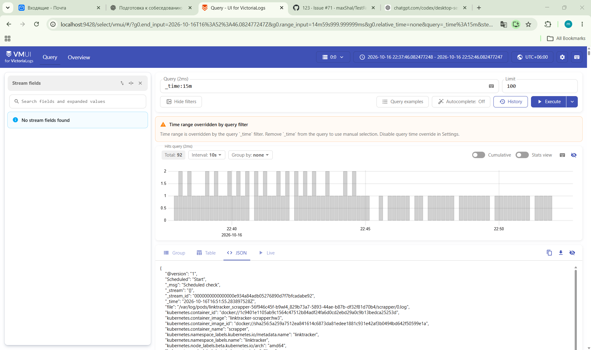
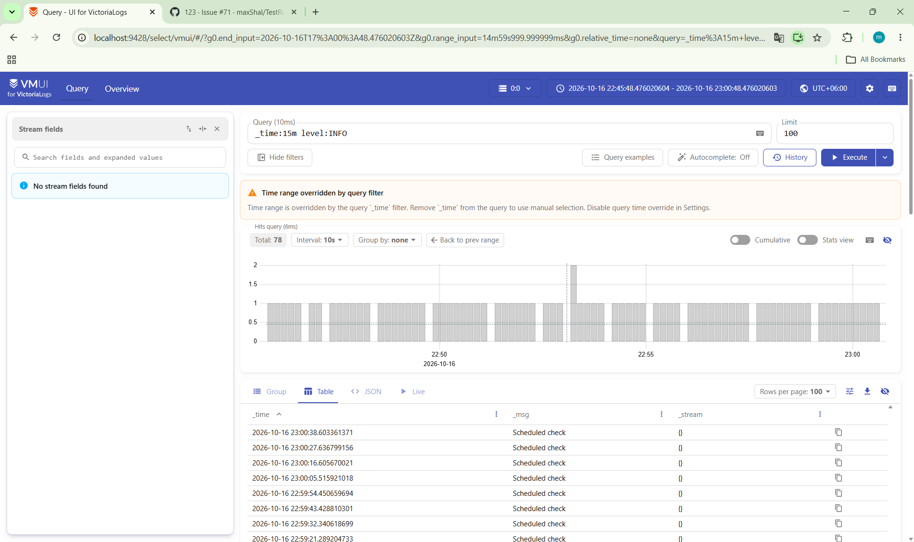
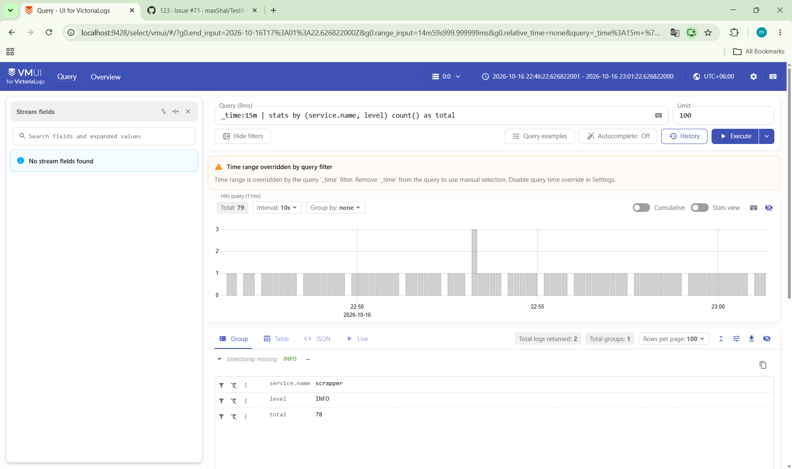
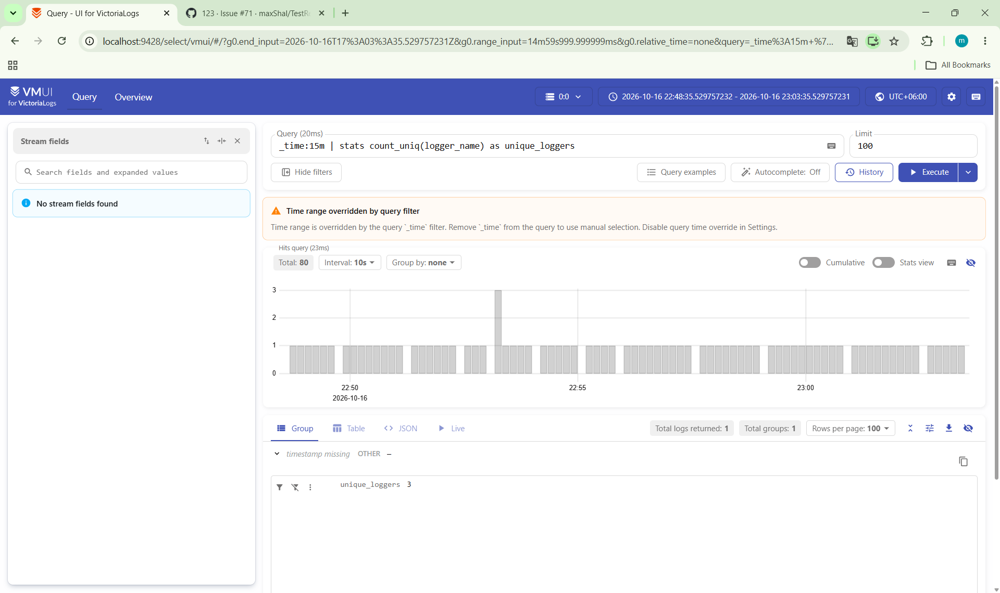

# Сбор логов LinkTracker в VictoriaLogs

Дата выполнения: 16 октября 2026 года.

## Схема и настройка

В существующем minikube-кластере с приложением LinkTracker в namespace `linktracker` развёрнуты single-node VictoriaLogs и Vector:

```text
bot / scrapper → stdout (JSON) → Vector (DaemonSet) → VictoriaLogs → vmui
```


## Запросы LogsQL

### 1. Сырые записи за последние 15 минут

```text
_time:15m
```

Возвращает исходные записи без группировки.



### 2. Фильтр по уровню логирования

```text
_time:15m level:INFO
```

Выбирает только записи с полем `level`, равным `INFO`, за последние 15 минут.



### 3. Количество записей с группировкой

```text
_time:15m | stats by (service.name, level) count() as total
```

`stats by (service.name, level)` объединяет записи по сервису и уровню. `count()` считает записи в каждой группе, `total` — имя поля с результатом.



### 4. Количество уникальных логгеров

```text
_time:15m | stats count_uniq(logger_name) as unique_loggers
```

`count_uniq(logger_name)` считает различные значения поля `logger_name`.



## Результат

JSON-логи приложения поступают через Vector в VictoriaLogs и доступны для поиска и агрегации в vmui.
